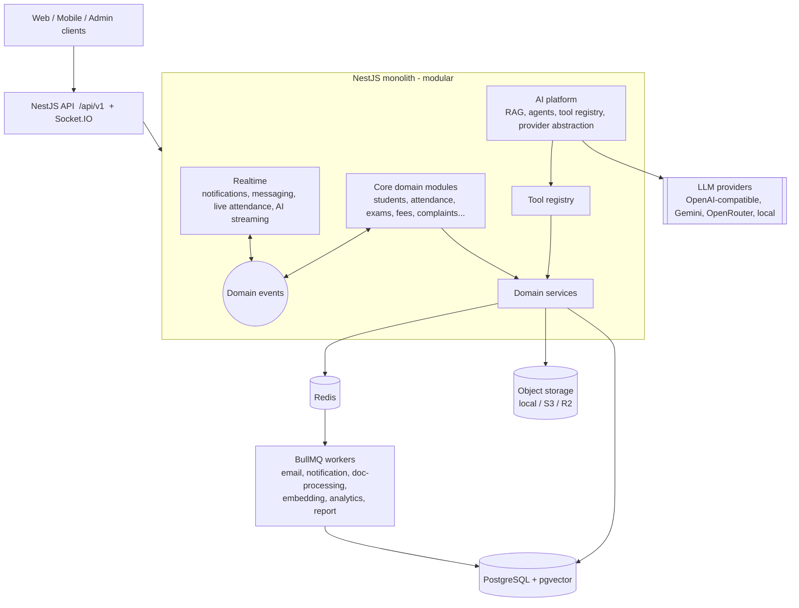
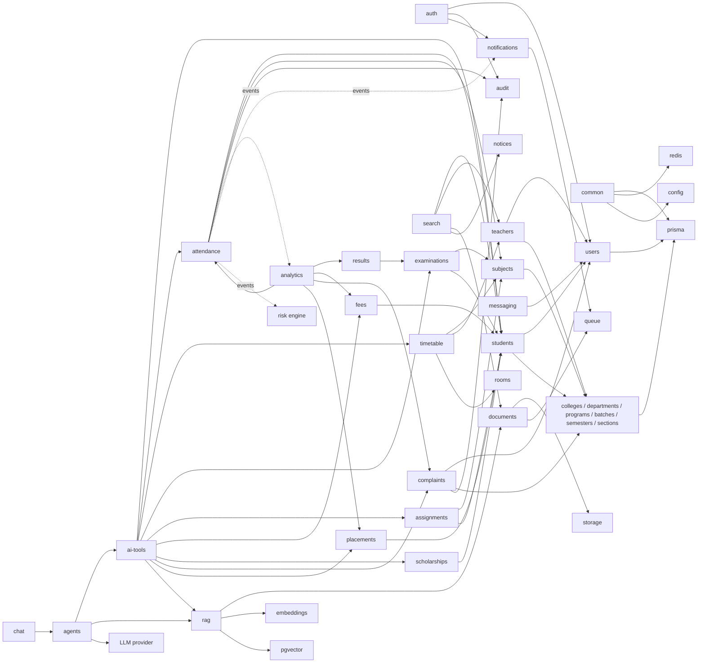
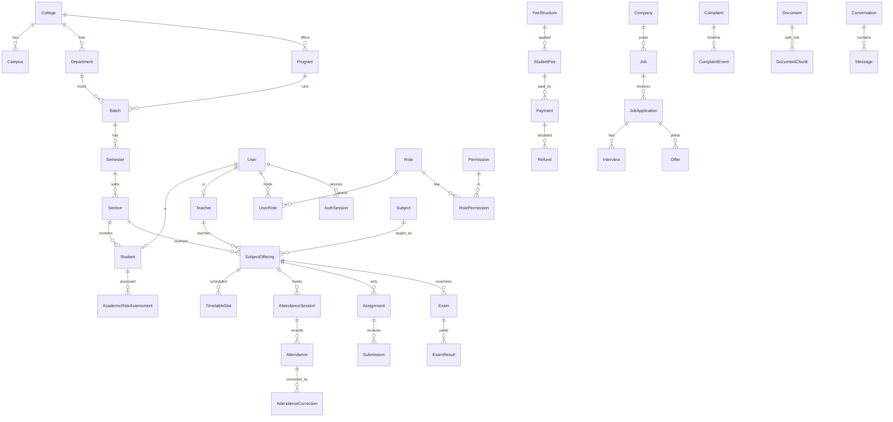

# College OS — Architecture

> **College Operating System + AI Copilot.** Core workflows (attendance, grievances, scholarships, placements) are
> automated and explained; the AI layer sits *on top of* services, never beside the database.

## 1. System overview



**Rules that hold everywhere**

1. Controllers: HTTP only. Business logic in services. DB access in services/repositories.
2. The LLM never touches the DB: `LLM → Tool → Service → DB`. Tools re-check permission and tenant on every call.
3. RAG permissions are enforced in the SQL `WHERE` clause *before* any text reaches the model.
4. Modules talk through domain events (`@nestjs/event-emitter` in-process, BullMQ for async work), not each other's internals.
5. Every query is tenant-scoped (`collegeId`); `RequestContext.requireTenantId()` throws if tenant is missing.

## 2. Module dependency graph



## 3. Folder structure

```
.
├── prisma/
│   ├── schema.prisma          # 63 models / 35 enums
│   └── sql/hardening.sql      # pgvector HNSW, tsvector GIN, append-only audit trigger
├── docker/postgres/init.sql
├── src/
│   ├── main.ts                # helmet, CORS, versioning, validation, swagger, shutdown hooks
│   ├── app.module.ts
│   ├── config/                # env validation (fail-fast) + typed AppConfigService
│   ├── common/                # filters, interceptors, middleware, decorators, dto, utils (request context)
│   ├── prisma/  redis/  queue/  health/
│   ├── auth/ users/ academic/ students/ teachers/ attendance/ timetable/ assignments/ examinations/
│   ├── fees/ scholarships/ placements/ complaints/ notifications/ realtime/ messaging/ campus/
│   ├── storage/ documents/ analytics/ reports/ search/ audit/ admin/ portal/ security/ access/
│   └── ai/{chat,rag,embeddings,document-processing,agents,tools}/
└── test/
```

## 4. ER overview (core relationships)



Design notes: `SubjectOffering` (subject × semester × section × teacher) is the anchor for attendance, exams,
assignments and timetable, which makes teacher-scope checks a single join. `DocumentChunk` denormalises
visibility/department/type so permission filters run inside the vector query. `AuditLog` and `ComplaintEvent`
deliberately have no FK to `User`.

## 5. Cross-cutting

| Concern | Approach |
|---|---|
| Tenancy | `collegeId` on every tenant table; `TenantGuard` populates `RequestContext` |
| AuthZ | Roles → Permissions (DB), `@RequirePermissions()` guard, plus resource-scope checks (teacher ↔ section) |
| Errors | Global filter → `{success:false, statusCode, message, errorCode, timestamp, requestId}`; no stack traces in prod |
| Responses | `{success, data, meta?, timestamp, requestId}`; lists use `Paginated` → `{data, meta:{page,limit,total,totalPages}}` |
| Logging | pino (JSON in prod), request ID on every line, auth/cookie/password redaction |
| Queues | 6 BullMQ queues, 5 attempts, exponential backoff, failed jobs retained as dead-letter set |
| Health | `GET /health` (liveness), `GET /health/ready` (PostgreSQL + Redis) |
| Shutdown | `enableShutdownHooks` + tini PID 1 → clean close of HTTP, Prisma, Redis, BullMQ |

## 6. Status

All 14 phases are implemented; see README "Verification status" for what has and has not been exercised against a real
database/LLM. Authentication, scope and AI flow details: [docs/SECURITY.md](docs/SECURITY.md), [docs/RAG.md](docs/RAG.md),
[docs/AI_AGENTS.md](docs/AI_AGENTS.md).
