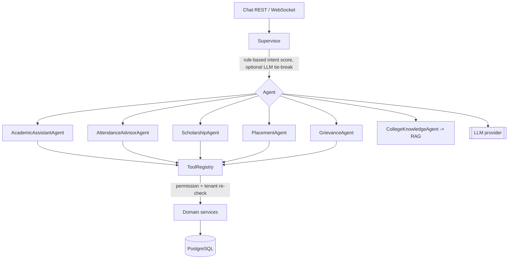

# AI platform: tools, agents, advisor

## Rules

- The LLM only sees **tool results**, never a DB handle. Every tool call re-checks the principal's permission and tenant.
- Tools are an **allow-list per agent**; unknown/forbidden tool requests are rejected with a safe error.
- Student-scoped tools go through `StudentResolver` (students → self, parents → their children, teachers/admins → by scope).
- Tool errors are sanitised before being shown to the model.
- No LLM configured / provider down → `DeterministicResponder` renders the tool data without the model.
- `AiCallLog` records provider, model, tokens, latency, status — **not** prompts or answers.

## Tools

`getStudentProfile`, `getAttendance`, `getTimetable`, `getUpcomingExams`, `getAssignments`, `getAcademicPerformance`,
`findStudents`, `getFees`, `searchScholarships`, `searchPlacementOpportunities`, `getComplaintStatus`, `whoShouldIContact`,
`createComplaintDraft`, `searchCollegeDocuments`.

## Supervisor

Scores the message against per-agent regex rules (e.g. "who should I contact", "marked me absent" → Grievance; "rules",
"policy" → Knowledge). Ties/low confidence may be resolved by one cheap LLM classification call. Cross-agent questions
run the primary agent only (documented simplification).

## Grievance assistant

`createComplaintDraft` stores a draft in Redis (TTL) containing category, priority and routing suggestion. **The AI never
submits.** The user reviews it and calls `POST /api/v1/ai/grievance/drafts/:id/confirm`. Sensitive keywords (harassment,
ragging, …) force CRITICAL priority and COLLEGE_ADMIN routing, and are never auto-filed.

## Personal advisor

`GET /api/v1/ai/advisor` builds a study plan from attendance shortage math, upcoming exams and pending assignments
(pure function `study-plan.ts`). Output is advice, **not a prediction**: risk text always states reasons and
uncertainty.

## Risk engine (`heuristic-v1`)

Weighted, explainable signals: attendance %, recent decline, absence streak, assignment lateness, marks trend, fee
overdue. Fewer than 5 data points → `LOW` with "insufficient data". Reasons are stored with each assessment.
Model version is stored so a future ML model can be compared side by side.
