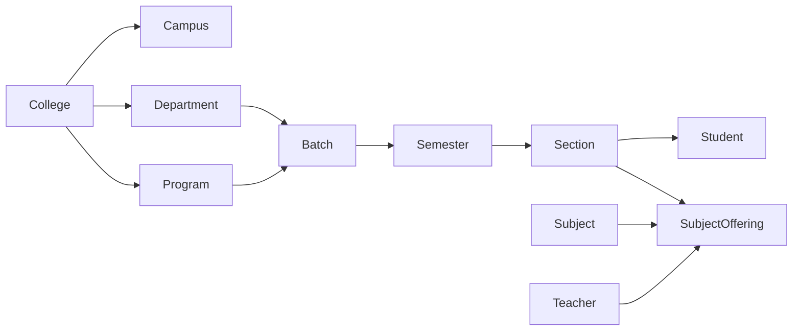

# Database

PostgreSQL 16 + `pgvector`. Prisma schema: `prisma/schema.prisma` (**63 models, 35 enums**).

## Tenancy

Every tenant table carries `collegeId`. `TenantGuard` puts the tenant in `RequestContext` (AsyncLocalStorage);
services call `RequestContext.requireTenantId()` and add it to every query. Ids supplied by clients (e.g. `sectionId`)
are verified by `OwnershipService.assert`, which answers **404** for cross-tenant ids. Only `SUPER_ADMIN` may override the
tenant via `x-tenant-id`.

## Hierarchy

`SubjectOffering` (subject × semester × section × teacher) anchors attendance sessions, exams, assignments and timetable
slots, so teacher-scope checks are one join.

## Main groups

| Group | Models (abridged) |
|---|---|
| Identity | User, Role, Permission, UserRole, RolePermission, AuthSession (refresh family, device) |
| Org | College, Campus, Department, Program, Batch, Semester, Section, Subject, Room |
| People | Student, Teacher, Guardian links, LeaveRequest |
| Academics | SubjectOffering, Enrollment, TimetableSlot, AttendanceSession, Attendance, AttendanceCorrection, Assignment, Submission, Exam, ExamResult |
| Finance | FeeStructure, StudentFee, Payment, Refund, Scholarship, ScholarshipApplication |
| Careers | Company, Job, JobApplication, Interview, Offer |
| Support | Complaint, ComplaintEvent (no FK to User, immutable timeline) |
| Campus | Notice, Event, Club, Conversation, ConversationParticipant, Message, Notification, PushDevice |
| AI | Document, DocumentChunk (vector(1536), tsvector), AiConversation/Message, AiCallLog (no prompts/answers), AcademicRiskAssessment |
| Audit | AuditLog (append-only) |

## `prisma/sql/hardening.sql` (idempotent — run after every migrate)

Prisma cannot express these, so they live in raw SQL:

- `CREATE EXTENSION vector`, HNSW index on `DocumentChunk.embedding` (cosine).
- Generated `tsvector` column `contentTsv` on `DocumentChunk` + GIN index for keyword search.
- Trigger rejecting `UPDATE`/`DELETE` on `AuditLog` (append-only).
- Supporting partial/composite indexes.

Run: `npm run db:harden` (the Docker entrypoint does it on every start).

## Migration workflow

1. `npx prisma migrate dev --name init` (first time) → commit `prisma/migrations/`.
2. Production: `prisma migrate deploy` then `db:harden`.
3. **Known caveat:** `contentTsv` is created by SQL, so `migrate dev` may report drift for it. Review the generated
   migration; do not let it drop the column.

## Money, time, ids

Money is stored in integer **paise** (no floats). Timestamps are UTC. Ids are cuid/uuid strings.
