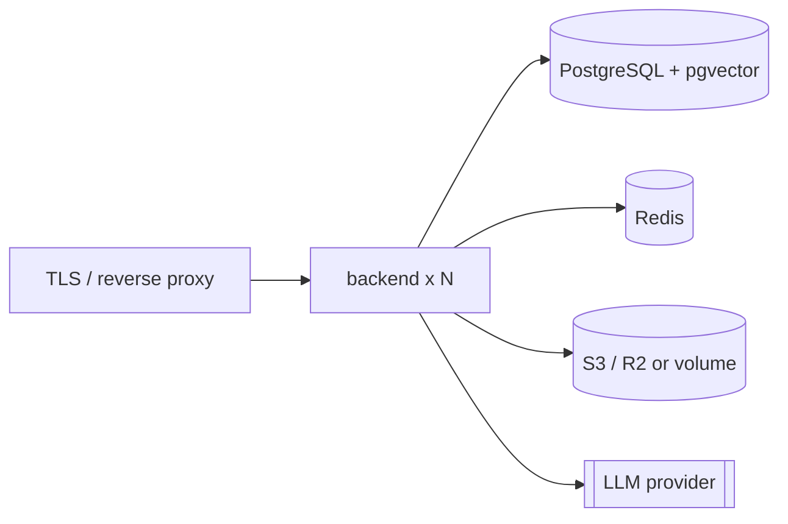

# Deployment

## Topology

The API process also runs BullMQ workers. For heavy load, run the same image as separate worker replicas (same code,
scale horizontally; Socket.IO needs sticky sessions or the Redis adapter if you add replicas).

## Docker

`docker compose up -d --build` starts pgvector/pg16, redis 7 and the backend. The container entrypoint:

1. `prisma migrate deploy` if `prisma/migrations/` exists; else `prisma db push` only when `ALLOW_DB_PUSH=true`; else exits with an error.
2. applies `prisma/sql/hardening.sql`;
3. `node dist/main` under `tini` (graceful shutdown, 20s grace).

The Prisma CLI is a runtime dependency so step 1–2 work in the pruned image.

## Environment

See `.env.example`. Required: `DATABASE_URL`, `REDIS_URL`, `JWT_SECRET`, `JWT_REFRESH_SECRET` (the app refuses to start
without strong values). AI: `AI_PROVIDER` (openai | gemini | openrouter | local), `AI_BASE_URL`, `AI_CHAT_MODEL`,
`AI_EMBEDDING_MODEL`, `AI_EMBEDDING_DIMENSIONS` (must match the `vector(1536)` column), provider key. Storage: `STORAGE_DRIVER`
(local | s3 | r2) + `S3_*`. Mail: `SMTP_URL`, `MAIL_FROM`.

## Release checklist

1. `npx prisma migrate dev --name init` locally; commit `prisma/migrations/`; remove `ALLOW_DB_PUSH`.
2. Set secrets in your platform's secret store.
3. `NODE_ENV=production` (disables Swagger, mock payments, seed).
4. Configure backups for Postgres; Redis persistence is optional but queued jobs are lost without it.
5. Replace `NoopScanner`; configure SMTP; set real gateway credentials.
6. Probe `GET /health` (liveness) and `GET /health/ready` (Postgres + Redis).
7. Monitor `GET /api/v1/admin/queues` and failed jobs.

## Scheduled jobs

BullMQ job schedulers (`upsertJobScheduler`, idempotent across replicas) register on startup: risk recompute (03:00),
attendance scan (06:00), fees due (08:00), scholarship deadlines (09:00), assignment deadlines (hourly), complaint SLA
sweep (every 15 min).
