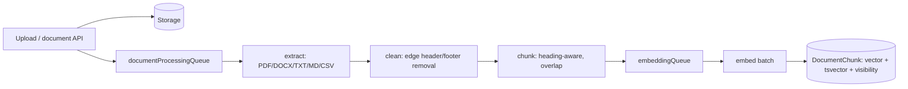
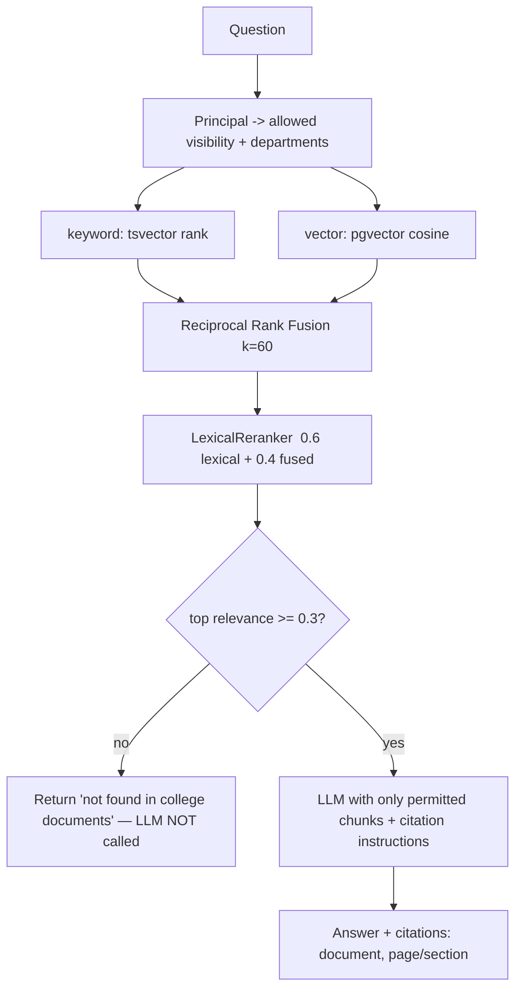

# RAG (permission-aware retrieval)

## Ingestion

- Files pass magic-byte validation, size limit (`MAX_UPLOAD_MB`) and a malware-scanner hook before storage.
- Each chunk **denormalises** `visibility`, `departmentId`, `documentType` and `collegeId` so access rules run inside SQL.
- Jobs retry 5× with exponential backoff; failures stay in the queue's failed set (dead-letter) and surface in
  `GET /admin/queues/:name/failed`.
- Scanned PDFs without a text layer are not OCR'd (documented limit).

## Query path

Guarantees:

1. **Filter before retrieval.** `chunkFilterSql(principal)` is part of the `WHERE` of both the keyword and vector queries,
   so unauthorised text never reaches the application, let alone the prompt.
2. **Refusal.** If nothing relevant is found the system answers that it could not find it and suggests who to contact; the
   model is not asked to guess.
3. **Citations.** Every answer lists the chunks used (`documentId`, title, page/section).
4. **No private data.** Messages and complaints are never indexed.
5. If embeddings are unavailable the path degrades to keyword-only.

The reranker sits behind a `RERANKER` interface; swap in a cross-encoder without touching callers.

Endpoints: `POST /api/v1/ai/rag/ask`, `POST /api/v1/ai/rag/search`.

## Limits

Retrieval SQL and pgvector were not executed in the build environment (no database). Tune `MIN_RELEVANCE`, chunk size and
RRF weights against real documents.
