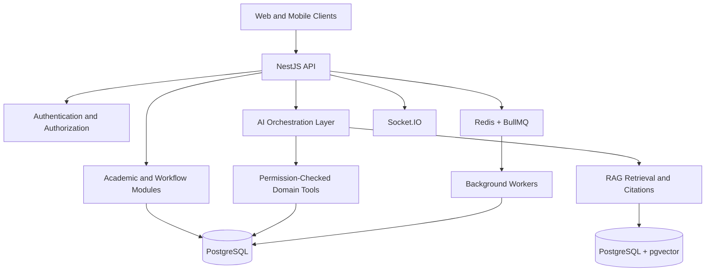

# College OS — AI-Powered College Operating System

> **Beyond Traditional ERP — An Intelligent Operating System for Modern Colleges.**

College OS is a modern college-management platform designed to improve the daily experience of students, teachers, HODs, and administrators. Instead of being a collection of disconnected forms and tables, it combines academic workflows, actionable insights, communication, and an AI assistant grounded in authorized college information.

## Vision

Build one reliable platform where people can find what they need, understand what needs attention, and complete college workflows without unnecessary friction.

## Core capabilities

- **Academic operations:** student and faculty profiles, departments, programs, sections, subjects, timetables, assignments, examinations, and results.
- **Attendance intelligence:** lecture-wise attendance, configurable thresholds, shortage alerts, trend analysis, and auditable correction requests.
- **College Knowledge AI:** retrieval-augmented generation (RAG) over approved policies, handbooks, circulars, syllabi, and other college documents, with source citations.
- **Workflow assistance:** complaint routing, scholarship discovery, placement matching, deadline reminders, and student support.
- **Role-aware workspaces:** tailored experiences for students, teachers, HODs, administrators, and support staff.
- **Notifications and collaboration:** in-app notifications, real-time updates, and authorized messaging.
- **Operational insights:** dashboards that highlight exceptions and actions—not just static counts.

## Planned technology stack

| Layer | Technology |
|---|---|
| Web frontend | Next.js App Router, React, TypeScript |
| UI | Tailwind CSS, shadcn/ui, Lucide |
| Client data | TanStack Query; Zustand only where needed |
| Backend | NestJS, TypeScript, REST API |
| Database | PostgreSQL, Prisma ORM |
| Vector search | pgvector |
| Jobs and cache | Redis, BullMQ |
| Realtime | Socket.IO |
| AI | Provider abstraction for compatible hosted or local models |
| Validation | DTO validation on the API; Zod on the frontend |
| Testing | Jest/Vitest, React Testing Library, Playwright |

The stack is a target architecture, not a claim that every integration is already implemented. See [ROADMAP.md](./ROADMAP.md).

## Architecture at a glance



## Repository layout

```text
college-os/
├── apps/
│   ├── web/                 # Next.js frontend
│   └── api/                 # NestJS backend
├── packages/
│   ├── types/               # Shared API/domain types, if needed
│   ├── ui/                  # Shared UI components, if needed
│   └── config/              # Shared tooling configuration
├── docs/
│   ├── ARCHITECTURE.md
│   ├── API.md
│   ├── DATABASE.md
│   ├── RAG.md
│   ├── AI_AGENTS.md
│   ├── SECURITY.md
│   ├── DEPLOYMENT.md
│   ├── CONTRIBUTING.md
│   └── ROADMAP.md
├── docker-compose.yml
└── README.md
```

Adapt the structure to the actual repository. Do not create placeholder packages unless they are useful.

## Local development

Prerequisites: Node.js LTS, a package manager, Docker, and Git.

1. Clone the repository.
2. Copy the relevant `.env.example` files to local environment files.
3. Start required infrastructure (PostgreSQL with pgvector, if enabled, and Redis).
4. Install dependencies.
5. Run Prisma migrations and seed development data.
6. Start the API and web app.

Exact commands depend on the package manager and scripts configured in the repository. Keep the setup instructions updated as implementation evolves. Never commit real secrets.

## Product principles

1. **Solve real problems first.** Every feature should reduce effort, improve clarity, or enable a better decision.
2. **The backend is authoritative.** UI checks are not a substitute for server-side authorization.
3. **AI is an assistant, not a source of truth.** Official policies and live records must be retrieved from authorized sources.
4. **Cite knowledge answers.** RAG responses should include verifiable source references when available.
5. **Protect student data.** Apply least privilege, tenant isolation, data minimization, and auditability.
6. **Design for failure.** Provide loading, empty, retry, and error states.
7. **Ship incrementally.** Prefer tested vertical slices over a huge, unverified code dump.

## Current status

This repository is under active development. Features described here may be planned rather than implemented. Consult the roadmap and issue tracker for current status.

## Documentation

- [Architecture](./docs/ARCHITECTURE.md)
- [API conventions](./docs/API.md)
- [Database design](./docs/DATABASE.md)
- [RAG pipeline](./docs/RAG.md)
- [AI agents and tools](./docs/AI_AGENTS.md)
- [Security model](./docs/SECURITY.md)
- [Deployment](./docs/DEPLOYMENT.md)
- [Contributing](./docs/CONTRIBUTING.md)
- [Roadmap](./docs/ROADMAP.md)

## License

Choose and add a license before accepting external contributions or distributing the project.
