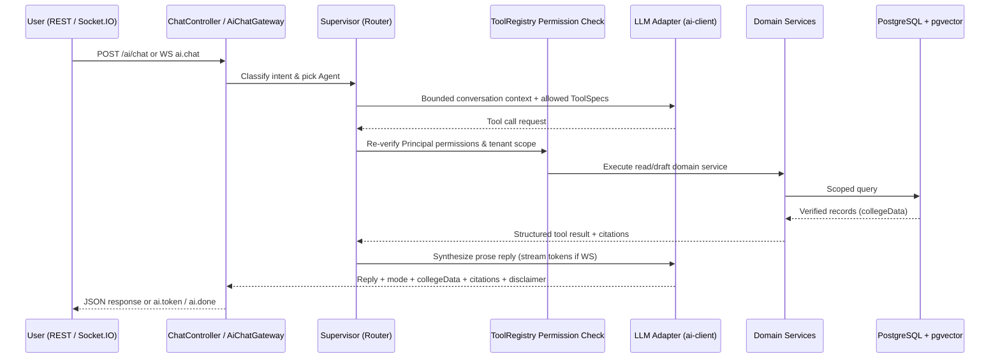

# AI Agents & Tool Calling

The AI layer (`Backend/src/ai/`) provides grounded institutional assistance through a controlled **Supervisor → Specialist Agent → ToolRegistry → Domain Service** architecture. The LLM never receives raw database credentials or SQL query capabilities.

## Request & Streaming Flow

## Implemented Specialist Agents (`Backend/src/ai/agents/`)

`Supervisor` (`supervisor.ts`) maintains **6** agents (with deterministic regex routing first, optional LLM tie-breaker, and `DeterministicResponder` offline fallback):

| Agent Name | Role & Scope |
| :--- | :--- |
| `AcademicAssistantAgent` | Timetable, exams, assignments, published marks/CGPA |
| `AttendanceAdvisorAgent` | Subject-wise attendance %, shortage math, recovery targets |
| `ScholarshipAgent` | Institutional/government scholarship matches & deadlines |
| `PlacementAgent` | Eligible jobs, placement drives, and recommendations |
| `GrievanceAgent` | Complaint routing guidance, status lookup, and confirmed draft preparation |
| `CollegeKnowledgeAgent` | Policy, syllabus, regulation, and handbook answers via RAG (`RetrievalService`) |

## Registered Domain Tools (`Backend/src/ai/tools/`)

`ToolRegistry` dynamically filters `ToolSpec[]` per request using `Principal.permissions` (`specsFor(p)`) and re-checks authorization at execution time (`execute(...)`):

- **Student & Academic Tools (`student-tools.ts`):** `getStudentProfile`, `getAttendance`, `getTimetable`, `getUpcomingExams`, `getAssignments`, `getAcademicPerformance`, `findStudents`
- **Campus & Operations Tools (`campus-tools.ts`):** `getFees`, `searchCollegeDocuments`, `searchScholarships`, `searchPlacementOpportunities`, `getComplaintStatus`, `whoShouldIContact`, `createComplaintDraft`

## Guardrails & Human-in-the-Loop

1. **Separated Fact vs. Suggestion:** Responses separate verified `collegeData` records from LLM prose and carry the standard AI disclaimer (`AI_DISCLAIMER`).
2. **Draft-Only Grievance Mutation:** `createComplaintDraft` writes a short-lived draft to Redis (with in-memory map fallback), returning `pendingDraftId`. A grievance is filed in PostgreSQL only after explicit user action via `POST /api/v1/ai/grievance/drafts/:id/confirm` (`ComplaintDraftService`).
3. **No Financial/Academic Admin Mutations:** AI cannot approve attendance corrections, alter grades, publish results, issue fee refunds, or modify user roles.
4. **Rate Limiting & Telemetry:** `ChatService` enforces a per-user sliding limit (`20` messages/min via Redis) alongside controller `@Throttle`, and records operational telemetry (`agentName`, latency, tokens, fallback/error status) in `AiCallLog` visible via `GET /api/v1/ai/admin/usage`.
5. **Proactive Advisor:** `GET /api/v1/ai/advisor` (`AdvisorService`) combines attendance risk, upcoming exam/assignment deadlines, and academic risk scores (supporting `studentId` for Guardian/Staff views).
