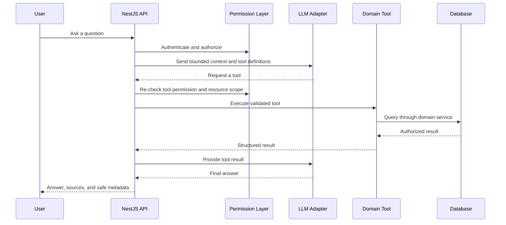

# AI Agents and Tool Calling

## Principle

The AI layer should be a controlled orchestration layer—not a chatbot with unrestricted database access. The model may request approved tools; NestJS validates permissions and executes each tool through normal domain services.

## Request flow

## Suggested agents or capabilities

Prefer small, testable capabilities over many autonomous agents:

- **College Knowledge:** policy and document questions using RAG.
- **Academic Advisor:** summarizes authorized attendance, deadlines, and performance data.
- **Scholarship Finder:** matches opportunities against explicitly required eligibility fields.
- **Placement Assistant:** helps discover relevant opportunities and explain eligibility.
- **Grievance Assistant:** helps classify and route a complaint, with user confirmation before submission.
- **Admin Insights:** summarizes aggregated, permission-appropriate operational metrics.

These are product concepts; implement only the capabilities that have reliable data and clear authorization rules.

## Tool registry

Potential tools:
- `getMyAttendance`
- `getMyTimetable`
- `getMyUpcomingExams`
- `getMyAssignments`
- `getMyFeeSummary`
- `searchCollegeDocuments`
- `searchEligibleScholarships`
- `searchPlacementOpportunities`
- `createComplaintDraft`
- `submitComplaint`
- `getComplaintStatus`

Each tool definition should include:
- stable name and description
- validated input schema
- required permission
- resource/tenant scope rules
- service implementation
- output schema
- timeout and error behavior
- audit requirements for mutations

Do not expose generic tools such as arbitrary SQL, unrestricted HTTP requests, or filesystem access.

## Read vs. write tools

Read tools can return authorized facts. Write tools must have stricter validation and may require confirmation. For example, an AI-generated complaint draft should be shown to the student before submission.

Never allow the model to approve attendance corrections, publish results, issue refunds, or change access permissions unless an explicit, separately authorized workflow permits it.

## Prompt-injection defense

- Treat user messages and retrieved documents as untrusted input.
- Keep system instructions and tool permissions outside retrieved content.
- Validate every tool call server-side.
- Limit tool output and context size.
- Do not expose hidden prompts, secrets, or internal reasoning.
- Require confirmation for consequential actions.
- Apply rate limits and per-user/tenant usage budgets.

## Observability

Capture only necessary metadata: provider/model, latency, token usage when available, tool name, result status, source IDs, and error category. Avoid storing full prompts or responses containing sensitive student data unless there is a clear purpose, access policy, and retention period.

Do not expose chain-of-thought. A user-facing activity panel may show safe details such as “Checked attendance record” or “Found 2 policy documents.”
