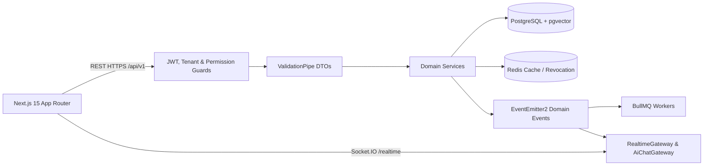

# System Architecture

College OS is structured as a **modular monolith** in NestJS paired with a **role-aware Next.js 15 App Router** frontend, backed by PostgreSQL (`pgvector`), Redis, and BullMQ.

## High-Level Request & Realtime Topology

## Backend Module Boundaries (`Backend/src/`)

- **Identity & Access:** `auth` (JWT access tokens, rotating refresh tokens, logout-all, password reset, email verification), `users`, `security` (`PrincipalService`, `TokenService`), `access` (`AccessService` row-level scope), `audit`.
- **Organization & Academics:** `academic` (colleges, campuses, departments, programs, batches, semesters, sections, subjects), `students`, `teachers`, `timetable` (slots, rooms, availability, exceptions, clash engine).
- **Academic Delivery:** `attendance` (scheduled roll call, monthly register, per-student analytics, shortage detection, anomaly scan, correction workflows), `assignments`, `examinations` (schedules, draft marks entry, grading schemes, GPA computation, result publication).
- **Student Services:** `fees` (fee structures, batch assignment, counter/online payments via `MockGateway` / `RazorpayGateway` / `StripeGateway`, signed webhooks, refunds, receipts), `scholarships`, `placements` (companies, jobs, drives, applications, interviews, offers), `complaints` (auto-classification, SLA tracking, desk routing, escalation, feedback), `campus` (notices, drafts, clubs, events).
- **Knowledge & AI:** `documents`, `storage` (`LocalStorage` / `S3Storage` + `ProductionMalwareScanner`), `ai` (`Supervisor`, 6 specialist agents, `ToolRegistry`, `RagAnswerService`, `RetrievalService`, `AdvisorService`, `ComplaintDraftService`, `AiChatGateway`).
- **Communications & Telemetry:** `messaging` (direct threads & department announcements), `notifications` (in-app, WebSocket, `EmailChannel`, `PushChannel` OneSignal/FCM, `WhatsAppChannel`), `realtime` (`RealtimeGateway`), `analytics` (overview, executive, HOD, correlation, high-risk), `reports` (CSV + async BullMQ exports), `queues`, `health`, `search`.

## Frontend Boundaries (`Frontend/src/`)

- **App Router Workspaces (`app/`):** Route groups and role portals across `48` compiled routes (`/student/*`, `/teacher/*`, `/hod/*`, `/admin/*`, `/accountant/*`, `/exam-controller/*`, `/placement-officer/*`, `/support/*`, `/library/*`, `/principal/*`, `/parent/*`, plus shared `/documents`, `/notices`, `/messages`, `/campus-life`, `/profile`, `/settings`).
- **State & Networking:**
  - `lib/api/client.ts` handles `Authorization: Bearer` headers, single-flight `401` token refresh rotation, binary downloads (`apiDownload`), and response envelope unwrapping.
  - TanStack Query manages server state; Zustand manages auth/session (`useAuthStore`), notifications (`useNotificationStore`), UI drawers (`useUIStore`), and AI chat (`useAIStore`).
  - `lib/socket/socketClient.ts` connects to `/realtime` (or falls back to 45s REST notification polling in serverless environments).
- **UI Security Rule:** Frontend navigation guards improve UX only; all permissions and row-level tenancy checks are enforced authoritatively by Backend guards and `AccessService`.

## Runtime Modes

1. **Always-On Container Mode (Docker / AWS ECS Fargate / EC2):** Full HTTP API, BullMQ workers (`AnalyticsProcessor`, `ReportProcessor`, notification & document queues), cron schedulers, and Socket.IO `/realtime` WebSockets (including `ai.chat` token streaming).
2. **Serverless Fallback Mode (`VERCEL=true` / unset `NEXT_PUBLIC_SOCKET_URL`):** BullMQ repeatable workers disable autorun, async report requests fall back to synchronous generation when queues are offline, and Frontend AI/notifications automatically use HTTP REST (`POST /api/v1/ai/chat` + polling).
