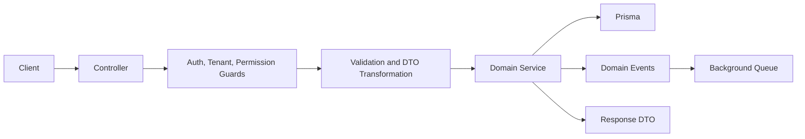

# Architecture

## Goals

- Keep academic business rules independent from controllers and UI components.
- Enforce authentication, tenant boundaries, and permissions at the API layer.
- Make AI providers replaceable without rewriting product workflows.
- Process slow or retryable work asynchronously.
- Support a modular monolith first; extract services only when justified by measured needs.

## High-level request flow

## Backend module boundaries

Recommended NestJS modules:

- `auth`: login, sessions, refresh-token rotation, password reset.
- `users`, `roles`, `permissions`: identity and authorization.
- `colleges`, `campuses`, `departments`, `programs`, `batches`, `sections`: institution structure.
- `students`, `teachers`, `subjects`, `enrollments`: academic identities and relationships.
- `attendance`: attendance records, summaries, correction workflow.
- `timetable`: schedules and conflict checks.
- `assignments`, `examinations`, `results`: coursework and assessment.
- `fees`, `scholarships`, `placements`: finance and opportunity workflows.
- `complaints`: case ownership, status transitions, SLA and escalation.
- `documents`, `rag`: ingestion, retrieval, citations, access filtering.
- `ai`: provider adapters, tool registry, orchestration and usage telemetry.
- `notifications`, `messaging`, `realtime`: user communications.
- `analytics`, `reports`, `audit`, `health`: cross-cutting capabilities.

Keep each module's controllers thin. Domain services should own validation of business rules and state transitions.

## Frontend boundaries

Use Next.js App Router with route groups for role workspaces. Organize code by feature, such as `attendance`, `assignments`, `complaints`, and `ai`. Keep shared UI primitives separate from feature-specific components.

Use:
- TanStack Query for server state and cache invalidation.
- React Hook Form + Zod for forms.
- A small global store only for client state that genuinely spans routes.
- A centralized typed API client for HTTP requests.
- Socket.IO for authorized real-time events.

The frontend may hide unavailable actions for usability, but every sensitive operation must still be authorized by the backend.

## Request lifecycle

1. Assign or validate a request ID.
2. Authenticate the user.
3. Resolve tenant context from trusted identity/session data—not an arbitrary client-supplied tenant ID.
4. Check role and resource-level permissions.
5. Validate and transform request DTOs.
6. Execute domain logic and database transaction as required.
7. Emit domain events only after successful state changes.
8. Return a stable response contract.
9. Record relevant audit and operational telemetry without logging secrets.

## Background processing

Use BullMQ for work that should not block an API request, such as document extraction, embedding generation, bulk notifications, exports, and scheduled reminders. Jobs should be idempotent where possible, have bounded retries, and expose failed-job monitoring.

## Architectural decisions

- Start as a **modular monolith**, not a microservice fleet.
- Use PostgreSQL as the system of record.
- Use pgvector for initial vector retrieval to reduce infrastructure overhead.
- Use provider interfaces for LLMs, embeddings, file storage, email, and payments.
- Add caching only where measured latency or load justifies it.
- Introduce separate services only when scaling, ownership, or deployment needs support the added complexity.
