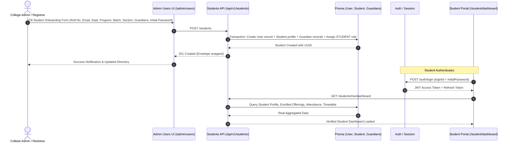
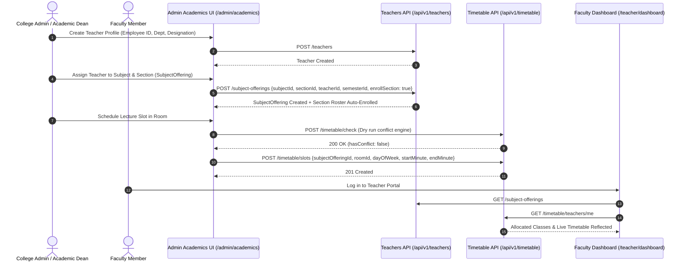
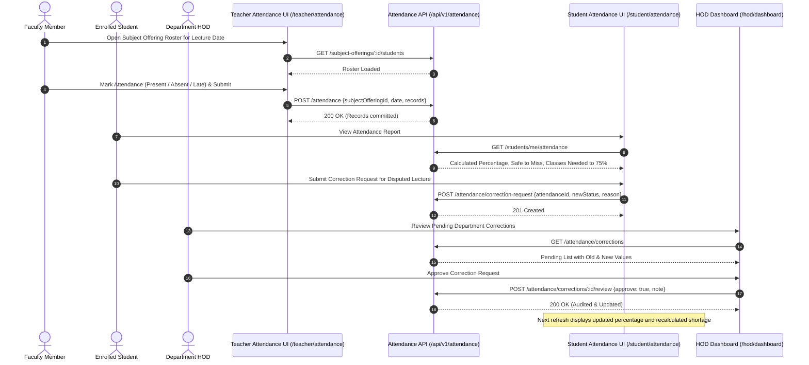
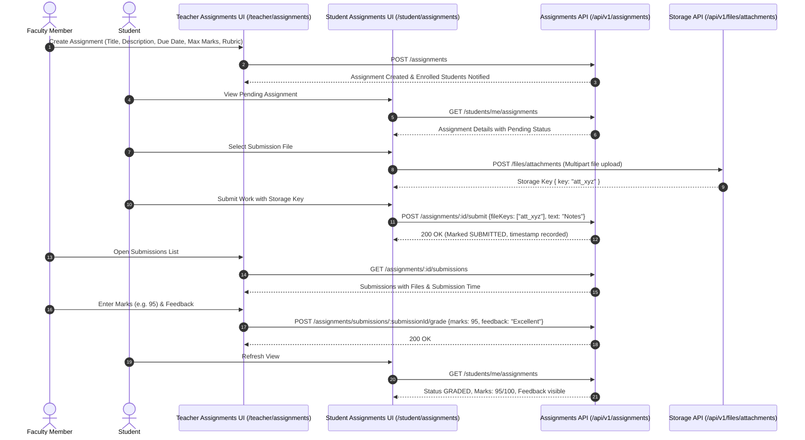
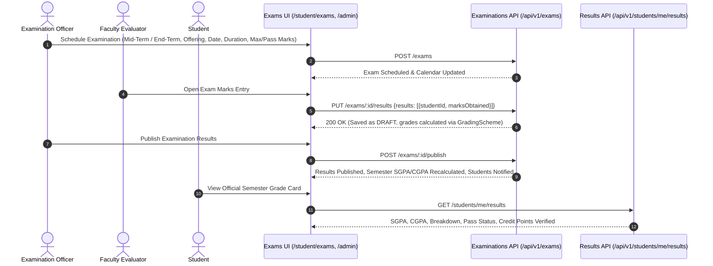
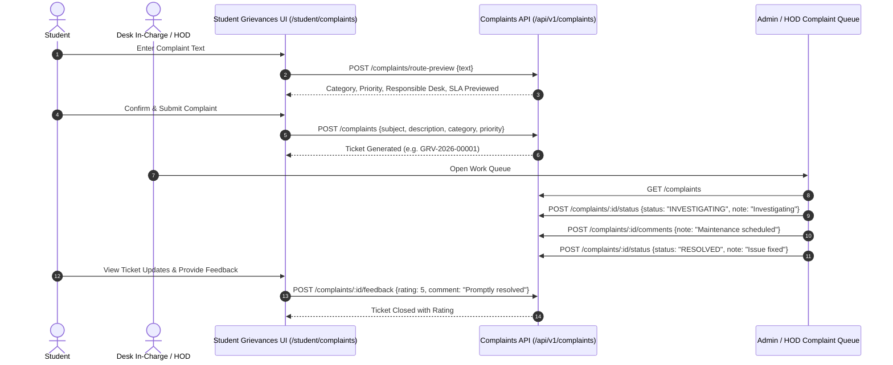
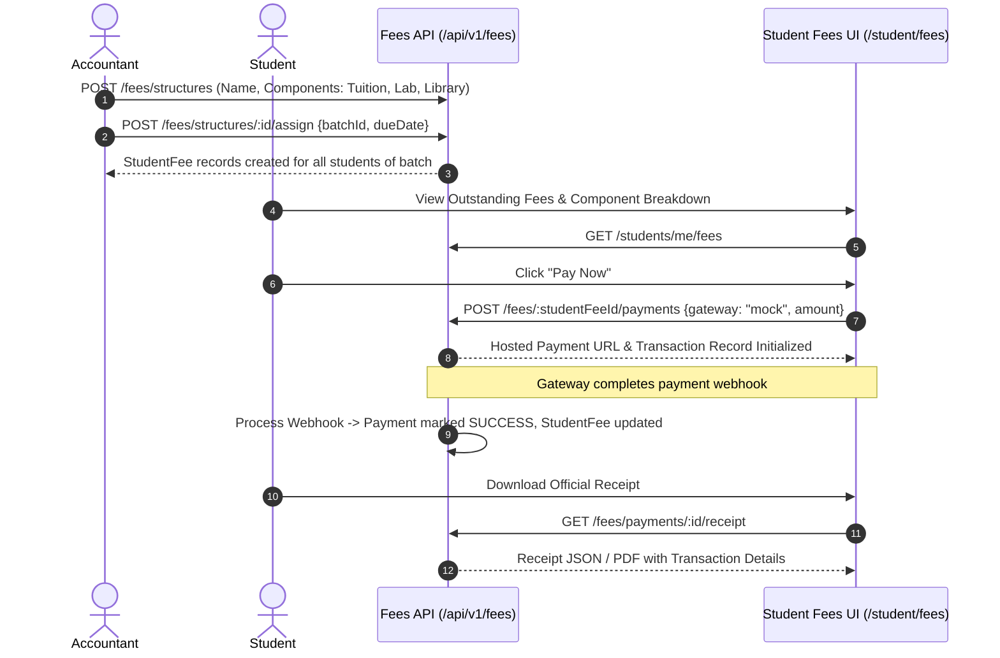

# College OS — Cross-Module Integration Workflows

This document details the multi-module business workflows in College OS, tracing how mutations in one domain propagate and reflect across other modules in the database and frontend user experiences.

---

## 1. Student Onboarding & Academic Activation Workflow

### Verification & Constraints
- Duplicate prevention: College Student ID, Roll Number, and Email are unique across the tenant. Retries return 409 Conflict.
- Relational integrity: Department, Program, Batch, and Section IDs must exist.
- Auth sync: Creating a student provisions a linked login account in `User` and generates a `STUDENT` role in `UserRole`.

---

## 2. Faculty Assignment & Timetable Allocation Workflow

### Verification & Constraints
- Conflict engine enforces zero overlap for teachers, rooms, and student sections.
- Roster automatic enrollment populates `Enrollment` records linking all section students to the offering.

---

## 3. Lecture Attendance, 75% Threshold & Correction Workflow

---

## 4. Assignment Creation, Submission & Grading Workflow

---

## 5. Examination, Result Publication & CGPA Recalculation Workflow

---

## 6. Grievance Lodging, Routing & Resolution Workflow

---

## 7. Fee Billing, Online Payment & Instant Receipt Workflow

