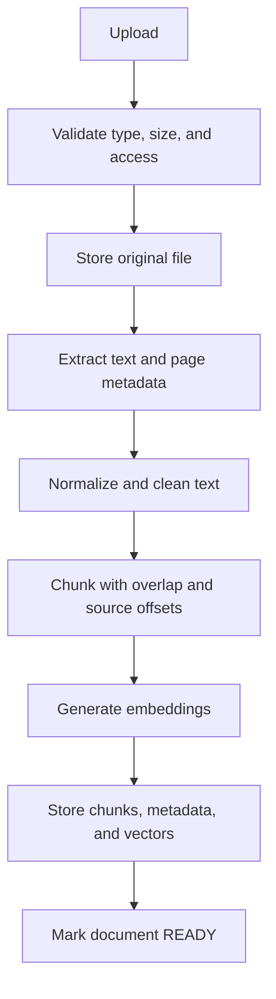

# Retrieval-Augmented Generation (RAG)

## Purpose

College Knowledge AI should answer questions from approved, permission-accessible college material and cite the sources used. RAG is for institutional knowledge; live or user-specific facts such as a student's attendance should come from authorized domain tools.

## Ingestion pipeline



Suggested document states: `UPLOADED`, `PROCESSING`, `READY`, `FAILED`, `ARCHIVED`.

Use a background queue for extraction and embedding. Make retries safe and avoid indexing duplicate versions unintentionally.

## Chunk metadata

Include as applicable:
- tenant/college ID
- document ID and version
- document type
- title and source URI
- page number or section heading
- department/program/semester scope
- visibility/access policy
- chunk index and text offsets
- ingestion timestamp and embedding model/version

## Retrieval pipeline

1. Authenticate the user and resolve trusted tenant context.
2. Determine allowed document scope using backend authorization rules.
3. Retrieve candidates using metadata-filtered vector search and, where useful, keyword search.
4. Optionally rerank candidates.
5. Apply a context budget and remove irrelevant/duplicate chunks.
6. Ask the model to answer only from the supplied evidence when the question requires college-specific facts.
7. Return answer text and structured source references.
8. Record privacy-aware retrieval and quality telemetry.

**Authorization must happen before content is sent to the model.** A prompt instruction alone is not access control.

## Response contract

A suggested shape:

```json
{
  "answer": "The policy states that ...",
  "sources": [
    {
      "documentId": "doc-id",
      "title": "Attendance Policy",
      "page": 12,
      "chunkId": "chunk-id"
    }
  ],
  "grounded": true
}
```

Only include source metadata that the user is allowed to see. Do not invent page numbers, document titles, or citations.

## Grounding and refusal behavior

- If evidence is missing or contradictory, say so.
- Distinguish official policy text from general explanation or AI-generated advice.
- Prefer the newest approved version when policies change.
- Treat retrieved documents as untrusted content, not instructions to the AI system.
- Do not let document text override system policies, permissions, or tool rules.
- Avoid sending unnecessary personal or financial data to an external model.

## Live data vs. RAG

Use domain tools for questions such as:
- “What is my current attendance?”
- “When is my next exam?”
- “Which assignments are due this week?”

Use RAG for questions such as:
- “What does the attendance policy say?”
- “Which documents are required for this scholarship?”
- “Explain the college examination rules.”

A query may use both, but each source should be clearly identified.

## Evaluation

Build a small approved evaluation set containing:
- question
- expected source document
- key facts expected in the answer
- user role/permission scope
- unanswerable examples

Track retrieval relevance, citation correctness, groundedness, latency, cost, and permission leakage tests. Do not evaluate only whether the answer sounds fluent.
